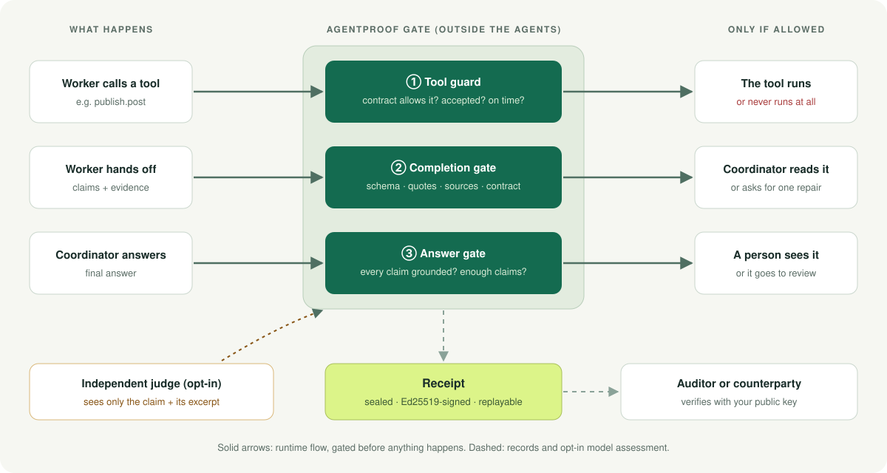
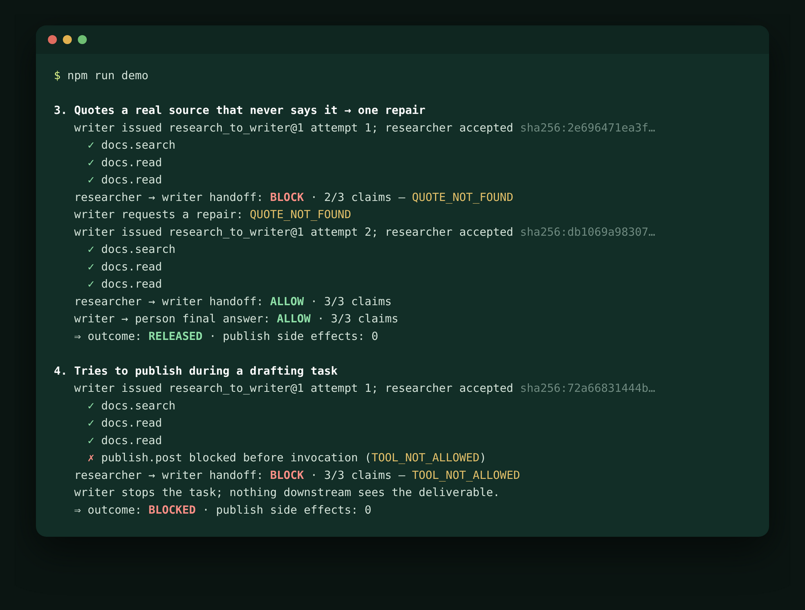
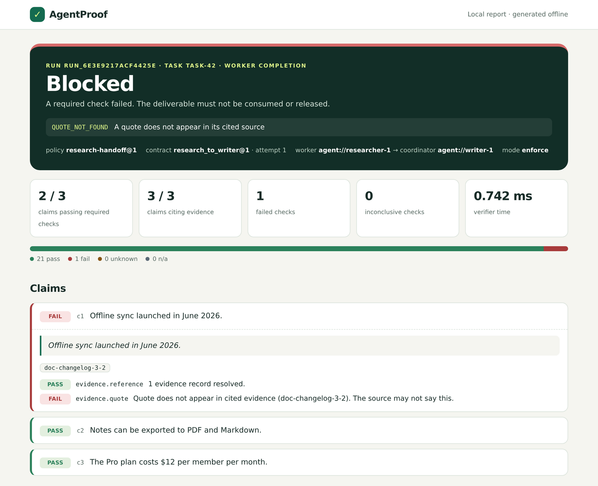
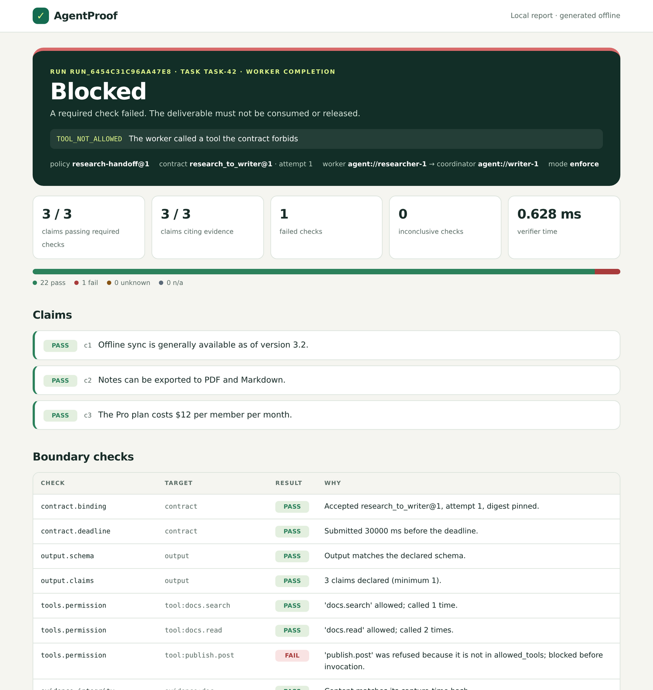
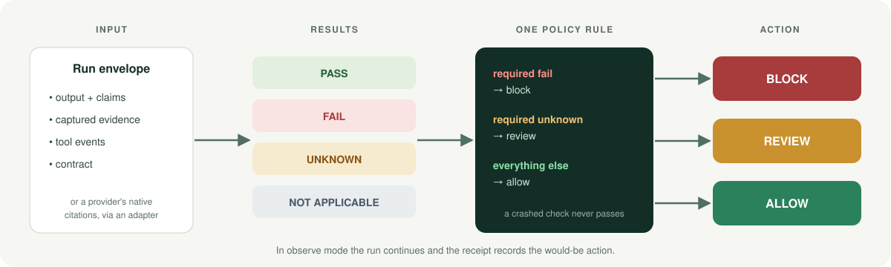

<p align="center">
  
</p>

<p align="center">
  <a href="https://github.com/PawanPatil19/agentproof/actions/workflows/ci.yml"></a>
  
  
  <a href="LICENSE"></a>
</p>

**AgentProof sits between AI agents and the things they hand work to.** Before
a worker's tool call runs, before a coordinator reads a worker's deliverable,
and before a person sees an answer, it checks the work against evidence and an
explicit contract. Then it writes a receipt that anyone holding your public key
can verify.

> **"Verified" always means *passed the recorded checks under a named
> policy*.** It never means true or safe. A found quote proves the source
> contains that text, not that the claim follows from it.

<p align="center">
  <a href="docs/assets/shopping-demo.mp4"></a>
</p>

<p align="center"><sub>An agent with a wallet shops under an SGD spending limit through the MCP gateway (<code>npm run demo:shop</code>). <a href="docs/assets/shopping-demo.mp4">Watch as MP4</a>.</sub></p>

## Why not let the agent check itself?

Models get better every month, so it's a fair question. A stronger model
fabricates fewer citations, and that part of the problem does shrink. What
doesn't shrink is the need for a check that the agent can't influence:

| Self-checking agent | AgentProof |
| --- | --- |
| Shares its own blind spots, context and any injected instructions | Runs outside the agent; an optional judge sees only a claim and its excerpt |
| "I won't call the publish tool" is a promise | The tool guard refuses the call before it runs |
| A different answer on every re-run | Deterministic checks; the same receipt on every replay |
| Policy lives in a prompt | Policy is a versioned, reviewable YAML file |
| A counterparty has to trust your agent's word | A counterparty verifies your signed receipt |
| Re-reading evidence costs tokens on every run | Deterministic checks take about 35 ms and no tokens |

The more autonomy agents get, the more an independent gate matters. The full
argument, including what this project deliberately doesn't do, is in
[docs/CRITIQUE.md](docs/CRITIQUE.md).

## How it works

<p align="center">
  
</p>

1. **Tool guard.** Every tool call a worker makes is checked against its
   contract before it executes: the tool name, and optionally its arguments
   (allowed values, a JSON Schema, per-call and total limits, a call count).
   The caller's identity comes from your code, never from the agent, so an
   agent can't borrow another agent's permissions.
2. **Completion gate.** The worker's deliverable is checked before the
   coordinator reads it: output schema, quotes found verbatim in the captured
   sources, allowed sources, numbers within tolerance, the exact contract
   accepted, the deadline met. A failed handoff comes back with a reason, so
   the coordinator can ask for one repair.
3. **Answer gate.** The final answer is checked before a person sees it. An
   answer that declares no claims is not "verified".

Every gate writes a **receipt**: a sealed JSON record of every check, the
policy version and the decision. It holds hashes and IDs, not your content,
and it can be **signed**: an Ed25519 DSSE signature over an in-toto
statement, so anyone can check it with standard tooling. Claim text is
committed with per-claim salts, so a receipt can't be used to confirm a
guessed claim. The format is in [docs/RECEIPT_SPEC.md](docs/RECEIPT_SPEC.md),
with test vectors.

## See it work

```bash
git clone https://github.com/PawanPatil19/agentproof.git && cd agentproof
npm install
npm run demo
```

<p align="center">
  
</p>

The demo runs five scenarios through the same researcher → writer workflow.
Above: a researcher quotes a real changelog that never says what it claims,
so the handoff is blocked and repaired. Then a researcher tries to publish
during a drafting task; the tool never runs and nothing downstream sees the
draft.

### An agent with a spending limit

```bash
npm run demo:shop
```

A shopping agent pays merchants through the [MCP gateway](packages/mcp-gateway).
The agent is a plain MCP client with no AgentProof code; the household's
[policy](examples/shopping-agent/agentproof.yaml) allows SGD only, three
approved merchants, at most SGD 80 a payment and SGD 150 in any 24 hours. Of
seven calls, three go through. The gateway stops a SGD 1,299 laptop, a merchant
nobody approved, a payment that would pass the 24-hour total, and a wallet key
export (as if a product page had talked the agent into it), all before they
reach the payments server. Every call leaves a signed receipt. The demo edits
the laptop receipt to say "allow" and re-seals it so its digest still matches;
the signature check rejects it:

```bash
npm run agentproof -- verify-receipt examples/shopping-agent/out/laptop-edited.json \
  --public-key examples/shopping-agent/out/issuer.pub
# ✗ not verified: the signature does not verify
```

The agent is scripted rather than a model, so every run makes the same calls.
The video is regenerated with `python3 scripts/record-shop-demo.py` (needs
[agg](https://github.com/asciinema/agg) and ffmpeg).

## What you get for every decision

Each receipt renders as a self-contained HTML report: no scripts, no
external assets, safe to open on hostile input.

<table>
  <tr>
    <td width="50%"></td>
    <td width="50%"></td>
  </tr>
  <tr>
    <td><b>A quote that isn't in the source.</b> The claim cites a real document; the document never says it.</td>
    <td><b>A forbidden tool.</b> <code>publish.post</code> was refused before it ran, and the deliverable is rejected.</td>
  </tr>
</table>

## From a run to a decision

<p align="center">
  
</p>

Checks never decide anything; they report. One rule, the same for every
check, turns results into an action: a required **fail → block**, a required
**unknown → review**, everything else **→ allow**. A crashed check never
passes. In **observe** mode work continues and the receipt records what
enforcement would have done, which is how you adopt it safely.

## Quick start

The [getting-started guide](docs/GETTING_STARTED.md) goes from clone to a
signed receipt in about ten minutes, offline. In short:

```bash
npm run agentproof -- inspect fixtures/runs/fabricated-quote.json   # diagnose, never blocks
npm run agentproof -- init                                          # starter agentproof.yaml
npm run agentproof -- check my-run.json --policy agentproof.yaml    # CI gate: exit 0 / 2 / 3
```

## Use it in code

### Gate a handoff between agents

```ts
import { createVerifier, FileStateStore } from "@agentproof/sdk";

const proof = await createVerifier({
  policyFile: "./agentproof.yaml",
  identities: { researcher: ["agent://researcher-1"], writer: ["agent://writer-1"] },
  // Contracts, tool usage and approvals survive a restart (one process per file).
  state: new FileStateStore("./agentproof-state/state.json"),
});

let contract = proof.issueContract("research_to_writer", {
  taskId: "task-42", worker: "agent://researcher-1", coordinator: "agent://writer-1",
});
contract = proof.acceptContract(contract, { identity: "agent://researcher-1" });

// Every tool call is checked before it runs.
const tools = proof.guardTools(realToolExecutor, contract, { identity: "agent://researcher-1" });
const { output, evidence } = await researcher.run({ tools });

// Gate the deliverable before the writer reads it.
const receipt = await proof.verifyCompletion({ contract, output, evidence, identity: "agent://researcher-1" });
if (receipt.decision === "allow") await writer.consume(output);
else if (receipt.decision === "review") await reviewQueue.add(receipt);
else contract = proof.retry(contract); // bounded; obligations are never weakened
```

The full workflow, with all three gates, is about 120 lines in
[`examples/research-handoff/src/workflow.ts`](examples/research-handoff/src/workflow.ts).

### Use your provider's native citations

No custom output format needed. If your model already returns citations,
an adapter builds claims and evidence from them. There are adapters for
Anthropic and OpenAI:

```ts
import { fromAnthropicMessage } from "@agentproof/core";

// `response` is a Messages API response; `documents` are the documents you sent, in order.
const { output, evidence } = fromAnthropicMessage(response, documents);
const receipt = await proof.verifyAnswer({ output, evidence });
```

```ts
import { fromOpenAIResponse } from "@agentproof/core";

// `response` is a Responses API response (file_search / web_search). Give each
// source you supplied the file ID, filename or URL that OpenAI will cite it by.
const { output, evidence } = fromOpenAIResponse(response, [
  { id: "changelog", aliases: ["file-abc123"], content: changelogText },
  { id: "docs", locator: "https://docs.example.com/capabilities", content: pageText },
]);
const receipt = await proof.verifyAnswer({ output, evidence });
```

Each citation becomes its own claim. Evidence content always comes from what
*you* supplied, never from the model's output, so a citation can't ground
itself. A citation to a file you didn't supply is blocked. A web citation
with no content you captured goes to review. OpenAI annotations carry no
cited text, so the quote is the annotated part of the answer, used only when
it reads like an excerpt. Pass `spanQuotes: false` if your model paraphrases.
`fromCitedSegments` is the provider-neutral version.

### Ask "does the claim follow?" without letting the agent grade itself

```ts
import { anthropicJudge } from "@agentproof/judge-anthropic";

const proof = await createVerifier({ policyFile: "./agentproof.yaml", judge: anthropicJudge() });
```

Turn it on with `checks.semantics.enabled: true`. The judge gets one claim
and one excerpt in a fresh request, with no tools and no agent context, and
only for quotes already found verbatim. Its verdict is labelled a *model
assessment*. A timeout, error or refusal goes to review, never to pass. Any
model works through the `Judge` interface.

### Prove who issued a receipt

```bash
npm run agentproof -- keys generate --out keys
npm run agentproof -- check run.json --policy agentproof.yaml --sign-key keys/agentproof-signing.key
npm run agentproof -- verify-receipt agentproof-reports/run.json --public-key keys/agentproof-signing.pub
# the same receipt as a standard DSSE envelope
npm run agentproof -- verify-receipt agentproof-reports/run.dsse.json --public-key keys/agentproof-signing.pub
```

In code: `createVerifier({ signingKeyPem, commitmentKey })` signs every
receipt. A counterparty checks it with `verifyReceiptSignature(receipt, publicKey)`,
or any DSSE verifier with `toDsseEnvelope(receipt)`. Keep the commitment key
(`generateCommitmentKey()`) if you may need to open a claim to an auditor
later with `discloseClaim`; see [docs/RECEIPT_SPEC.md](docs/RECEIPT_SPEC.md).

## CLI

| Command | Purpose | Exit |
| --- | --- | --- |
| `inspect <run.json>` | Diagnose with the baseline preset; never blocks | 0 |
| `check <run.json> --policy f [--mode] [--sign-key] [--commitment-key]` | CI gate | 0 allow · 2 block/review · 3 error |
| `report <receipt.json> [--run run.json]` | Render a receipt as HTML | 0 · 3 |
| `init [--template research-handoff]` | Write a starter policy (observe mode) | 0 |
| `policy validate <file>` | Compile and validate a policy | 0 · 3 |
| `keys generate` | Create an Ed25519 signing key pair | 0 |
| `verify-receipt <r or r.dsse.json> --public-key f` | Check who issued a receipt, and that it's unedited | 0 · 2 |
| `prune [--days 7]` | Delete receipts past retention | 0 |

`npm run agentproof -- <command>` runs from source. For an `agentproof`
binary, run `npm run build && npm install`.

## Policy

```yaml
api_version: agentproof/v1
policy: { id: research-handoff, version: 1 }
mode: enforce                        # or observe
checks:
  evidence:
    min_claims: 1                    # an answer with no claims isn't verified
    require_quote: true              # each claim quotes its source verbatim
    allowed_source_ids: [product-docs, changelog]
  semantics: { enabled: false }      # opt-in independent judge
contracts:
  research_to_writer:
    version: 1
    coordinator: writer
    worker: researcher
    deadline_ms: 30000
    allowed_tools: [docs.search, docs.read]   # tools are denied by default
  pay_invoice:
    version: 1
    coordinator: treasury
    worker: payer
    deadline_ms: 3600000
    allowed_tools: [payments.send]
    tool_constraints:                          # what the worker may do *with* a tool
      payments.send:
        args_schema: { type: object, required: [amount, currency, to] }
        allowed_values: { currency: [SGD, USDC], to: [merchant-a, merchant-b] }
        amount_field: amount                   # dotted path into the arguments
        max_per_call: 50
        max_total: 200                         # across every attempt of the task
        max_calls: 10
        window_ms: 86400000                    # optional: make the totals rolling
enforcement:
  advisory_checks: [evidence.freshness]       # shown, never blocks
```

Unknown keys are rejected. Checks that guard the boundary itself can't be
made advisory. A call that breaks a tool constraint is refused with
`TOOL_ARGS_INVALID` or `TOOL_LIMIT_EXCEEDED` before the tool runs, and each
tool event in the receipt records the metered `amount` and the authority
`consumed` so far. Usage is saved before the tool runs; if it can't be
saved, the call doesn't happen. The MCP gateway issues one task per tool
call, so behind it use `window_ms` to make `max_total` and `max_calls` hold
across calls. The full commented template comes from `agentproof init`.

## Repository

```
packages/core             pure engine: policy, checks, decisions, receipts, adapters, signing, report
packages/sdk              runtime gates: contracts, tool guard, judge wiring, approvals, receipt store
packages/cli              the agentproof command
packages/judge-anthropic  reference independent judge backed by Claude
packages/mcp-gateway      MCP proxy: gates every tool call of any MCP client and writes a receipt
examples/                 research-handoff: the two-agent reference app; shopping-agent: spending limits through the MCP gateway
fixtures/                 30 reviewed failure-mode runs and a provider response
docs/                     GETTING_STARTED, DESIGN, CRITIQUE, images
```

```bash
npm test        # 230 tests
npm run bench   # 20 claims, ~1 MB evidence, 1,000 runs → p95 ≈ 35 ms
npm run build   # TypeScript project references → dist/
```

## Limits

- A cited source can be wrong. Quote grounding proves presence, not truth.
- Only declared claims are checked; anything the agent didn't claim isn't.
- The semantic judge is a model. Its verdicts are assessments, and it is off by default.
- In-process gates assume a trusted host; a compromised app can bypass them.
- Replaying a run with `check` can't undo actions that already happened.
- Redaction is best-effort pattern matching.

## License

MIT. "AgentProof" is a working name; package and trademark availability
haven't been checked.
